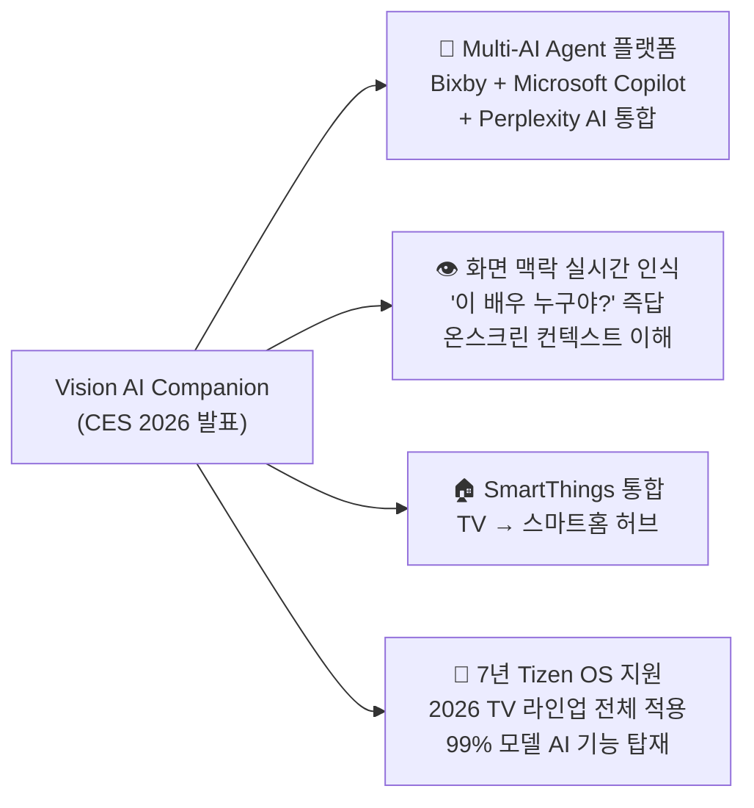
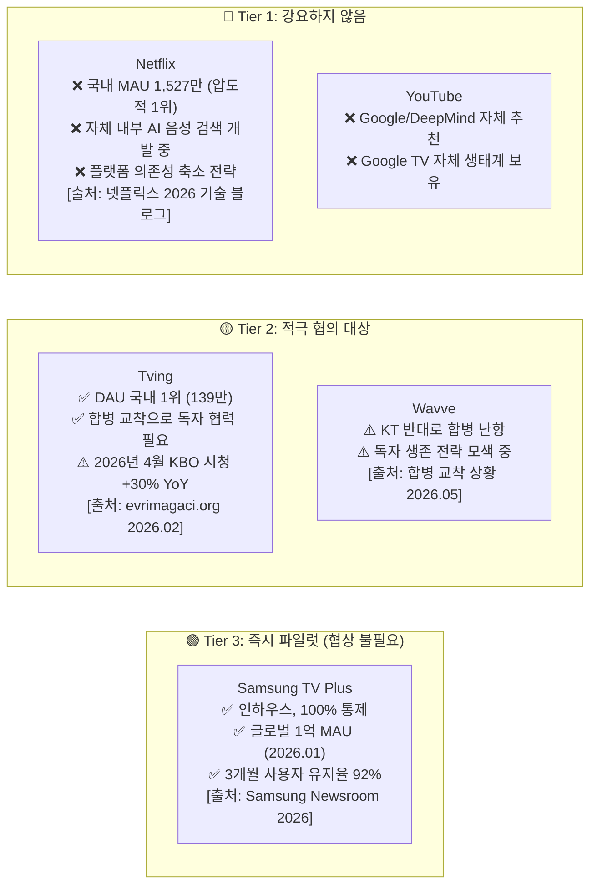
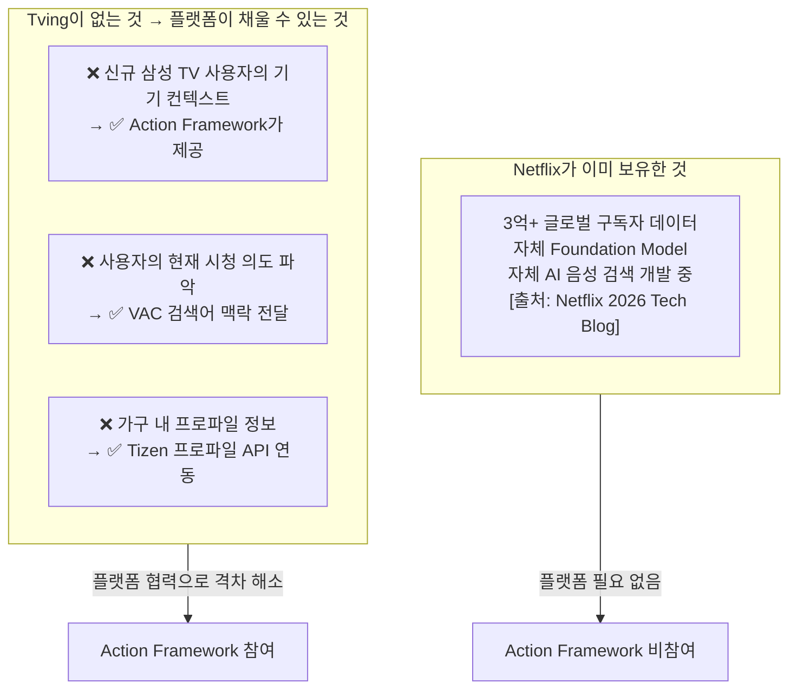
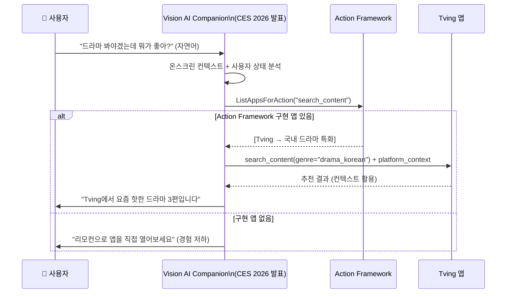

# Tizen Action Framework 2.0: 현실 기반 앱 채택 전략 v2.1

> **버전**: v2.1 — 2026년 4월 이후 최신 데이터 기반 출처 전면 갱신  
> **배경**: Action Framework 현황 재검토 → 인하우스/마이너 앱 우선 공략 + Platform Context 활용 전략  
> **작성일**: 2026-06-01

---

## 1. 현실 진단 (2026년 6월 기준 최신 시장 현황)

### 1.1 삼성 플랫폼의 현재 위치

| 지표 | 수치 | 출처 |
| :--- | :--- | :--- |
| 삼성 글로벌 TV 시장 점유율 (Q1 2026) | **19.1%** (1위, 약 900만 대) | TrendForce, 2026 Q1 [1] |
| Tizen OS 스마트TV OS 점유율 | **약 23%** (2020년 34%에서 하락, Google TV에 압박) | 업계 분석 자료, 2026초 [1] |
| Samsung TV Plus 글로벌 MAU | **1억 명 돌파** (2026년 1월 공식 발표) | Samsung Newsroom, Jan 2026 [2] |
| Samsung TV Plus 스트리밍 시간 증가 | **전년 대비 +25%** (2025 연간) | Samsung Newsroom, 2026 [2] |
| Samsung TV Plus 3개월 사용자 유지율 | **92%** | Samsung Newsroom, 2026 [2] |

> [!IMPORTANT]
> Tizen OS의 OS 점유율은 23%까지 하락하고 있습니다 [1]. 삼성 Visual Display Division은 2026년 5월 새 리더십 하에 **하드웨어 중심에서 플랫폼/소프트웨어 중심**으로 전략 전환을 공식화했습니다. Action Framework는 이 전략 전환의 핵심 enabler가 될 수 있습니다.

### 1.2 2026년 핵심 컨텍스트: Samsung Vision AI Companion (VAC)

삼성은 CES 2026에서 **Vision AI Companion (VAC)**을 발표했습니다 [3]. 이는 Action Framework 전략에 매우 중요한 새 현실입니다.



**Action Framework와의 연결점**: VAC가 앱에 "플레이 명령"을 내릴 때, 표준화된 인터페이스(Action Framework)가 없으면 VAC는 각 앱을 개별로 처리해야 합니다. Action Framework는 **VAC의 앱 제어 효율을 극적으로 높이는 미들웨어**로 포지셔닝할 수 있습니다.

> [출처] Samsung CES 2026 Vision AI Companion 발표, samsung.com; The Lec 분석, thelec.net

### 1.3 국내 OTT 시장 현황 (2026년 2월 기준, 최신)

| 서비스 | MAU | DAU | 특이사항 |
| :--- | :--- | :--- | :--- |
| **Netflix** | **1,527만** | 측정치 미공개 | 국내 OTT 시장 1위 유지 |
| **쿠팡플레이** | **832만** | **86만** | Rocket WOW 회원 번들 |
| **Tving** | **733만** | **139만** | DAU는 국내 최고 수준 |
| **Wavve** | 측정치 미공개 | **84만** | 합병 난항으로 단독 존속 위기 |

> [!NOTE]
> **Tving의 핵심 경쟁력**: 총 MAU는 쿠팡플레이보다 낮지만 **DAU는 139만으로 압도적 1위** (쿠팡플레이 86만, Wavve 84만) [4]. 일일 재방문율이 높다는 것은 충성 사용자가 많다는 의미이며, 이들에게 Samsung TV 중심의 추천 채널이 생기면 효과가 큽니다.

> [출처] OTT 사용자 통계, evrimagaci.org 집계 데이터, 2026년 2월 기준 [4]

### 1.4 Tving-Wavve 합병 현황 (2026년 5월 기준)

- **합병 상태**: 사실상 교착(Deadlock). 공정위 조건부 승인(2025년 6월)에도 불구, KT가 Tving 지분 13.54% 보유 주주로서 동의 거부 지속 [5]
- **KT 반대 이유**: 합병이 자사 IPTV 사업에 부정적 영향을 미칠 것을 우려 [5]
- **규제 조건**: 공정위는 2026년 12월 31일까지 기존 구독 가격 유지 의무화 [5]
- **현실적 함의**: 합병이 성사될 경우 양사 합산 MAU **약 1,100만+**로 Netflix(1,527만)를 위협하는 국내 2위 사업자 탄생 가능 [4]

> **전략적 기회**: Tving과 Wavve는 합병 교착 상황에서 **독립적 생존 전략이 절실**합니다. Samsung TV 플랫폼 협력은 이들에게 Netflix 대비 약세인 TV 시장 접근성을 보완하는 수단이 됩니다.

---

## 2. 서비스 등급별 현실 기반 공략 전략 (2026년 6월 수정판)

### 2.1 Tier 분류 재정의



### 2.2 Tier 3 — Samsung TV Plus: 즉시 파일럿 실행 계획

**목표**: Vision AI Companion(VAC)의 첫 번째 표준 Action 연동 앱으로 TV Plus를 포지셔닝합니다.

**VAC ↔ Action Framework ↔ TV Plus 연동 시나리오**:
```
사용자: "야구 중계 틀어줘" (Bixby/VAC 음성 명령)
   ↓
VAC → Action Framework: ListAppsForAction("watch_live_sports")
   ↓
Action Framework: TV Plus가 표준 구현 → 우선 반환
   ↓
VAC → TV Plus: execute play_content(sport="baseball", is_live=true)
   ↓
플랫폼 컨텍스트 자동 주입: { time_slot: "evening_prime", profile: "adult" }
```

**측정 KPI**:
- VAC 음성 명령 → TV Plus 진입 비율 (기준선 대비 변화)
- 콘텐츠 로드 완료까지 걸리는 클릭 수 (기존 대비 단축)
- VAC 경유 TV Plus 세션의 평균 시청 시간 (직접 진입 대비)

### 2.3 Tier 2 — Tving: 합병 공백기 맞춤 협상 전략

**협상 타이밍**: Tving은 합병 교착(2026년 5월 현재 진행 중) 상황에서 단독으로 경쟁력을 높여야 하는 압박을 받고 있습니다. 이 시점이 **외부 플랫폼 협력에 가장 열려 있는 창문**입니다.

**Tving에게 실질적으로 유용한 플랫폼 데이터 (제공 가능)**:

| 제공 데이터 | Tving에 주는 가치 | 기술 메커니즘 |
| :--- | :--- | :--- |
| **시간대 컨텍스트** | "저녁 금요일" → 장편 영화/드라마 추천 강화 | Level 1, 동의 불필요 |
| **활성 프로파일 유형** | "어린이 모드 활성" → 전체관람가 우선 표시 | Level 1, 동의 불필요 |
| **기기 지역/언어 설정** | 한국어 기기 → 한국 드라마 우선 | Level 1, 동의 불필요 |
| **최근 검색어** | "오징어게임" 검색 후 Tving 진입 → 유사 장르 즉시 추천 | Level 2, 사용자 동의 필요 |
| **구독 앱 목록** | Tving 앱 로그인 여부 확인 → VAC 추천 목록에 포함 여부 결정 | Level 2, 사용자 동의 필요 |

**Tving 설득용 핵심 데이터 포인트**:
1. **Samsung TV는 국내 TV Q1 2026 기준 1위 유지** [1] — 삼성 TV 사용자가 Tving 앱을 먼저 보게 됨
2. **Tving DAU 139만명은 KBO 야구 시청이 2026년 4월 기준 전년 대비 +30% 급증** [6] — 스포츠 콘텐츠 중심의 실시간 액션 연동이 바로 Tving의 강점과 맞닿아 있음
3. **Netflix 대비 MAU 격차**: Netflix 1,527만 vs Tving 733만 [4] — 삼성 플랫폼 채널을 통한 트래픽 증대가 격차 완화에 기여

---

## 3. 플랫폼이 실제 제공할 수 있는 컨텍스트 정보 (2026년 기준)

### 3.1 Netflix가 가지고 있는 것 vs Tiving이 없는 것

Netflix는 2026년에도 자체 내부 AI 음성 검색("I need a good cry" 같은 자연어 검색) 기능을 앱 내에서 개발 중입니다 [7]. 이는 플랫폼 AI 우회 전략의 일환입니다.

반면 **Tving/Wavve는 이런 자체 AI 인프라가 없습니다**. 신규 Samsung TV 사용자가 처음 Tving을 켰을 때 개인화 추천 데이터가 전혀 없습니다. 이것이 플랫폼 컨텍스트가 **즉각적이고 실질적인 가치**를 주는 지점입니다.



### 3.2 즉시 제공 가능한 컨텍스트 (Level 1 — 동의 불필요)

```json
// Action 실행 시 플랫폼이 자동으로 AppControl extras에 첨부하는 컨텍스트
{
  "platform_context": {
    "time_slot": "evening_prime",      // 19:00~23:00 (TV 시청 최성수 시간)
    "day_of_week": "saturday",         // 토요일 → 스포츠/영화 가능성
    "device_region": "KR",
    "device_language": "ko",
    "active_profile": "adult",         // 어린이 모드 아님
    "foreground_duration_sec": 120     // 방금 앱을 켰음 (첫 화면)
  }
}
```

### 3.3 사용자 동의 기반 컨텍스트 (Level 2)

Samsung Knox Security 기반 [3]으로 사용자 동의 하에 수집하며, 앱에는 익명화된 형태로만 전달합니다 (Apple의 Semi-anonymous Subscriber ID 방식 참조 [8]).

```json
{
  "platform_context": {
    "recent_search_terms": ["오징어게임", "드라마"],  // 최근 VAC 검색
    "subscribed_appids": ["com.tving.app", "com.tvplus.samsung"],
    "category_preference_hints": ["drama_korean", "sports_live"]  // 집계 추론값
  }
}
```

---

## 4. ACR 데이터 활용 현황 및 한계 (2026년 기준 업데이트)

삼성의 ACR(Viewing Information Services)은 현재 **외부 개발자 API로 공개되지 않습니다** [9]. Samsung Ads 플랫폼을 통한 광고주 대상 집계 데이터만 제공하며, 개별 앱에 원시 시청 이력을 제공하지 않습니다.

2026년 현재 추가로 주의해야 할 맥락:
- **삼성 2026 TV 전 모델에 Samsung Knox Security 탑재** [3] — 이는 개인정보 보호 강화 의지의 표현
- **ACR 직접 공유는 법적 리스크** 지속 (미국, EU GDPR 등)

**따라서 전략은**: ACR 원시 데이터를 앱에 넘기는 것이 아니라, **플랫폼이 내부적으로 참조하여 안전한 형태의 컨텍스트 신호만 Action 실행 시 주입**하는 방식으로 합니다.

---

## 5. Vision AI Companion이 Action Framework의 채택 동인이 되는 구조

2026년의 새로운 핵심 레버는 VAC입니다 [3]. VAC는 Bixby, Copilot, Perplexity를 통합한 멀티 AI 에이전트 플랫폼으로, TV 앱들과 자연어로 상호작용해야 합니다.

**VAC가 Action Framework를 채택 동인으로 만드는 이유**:



**앱 개발사에 전달할 메시지**: "VAC와 연동되지 않은 앱은 '음성으로 바로 실행'되지 않습니다. 사용자가 VAC에 말을 걸면 여러분의 앱이 자동으로 제안되거나, 아니면 아무 반응이 없거나, 둘 중 하나입니다."

---

## 6. 단계별 실행 로드맵 (2026년 6월 기준 현실화)

```mermaid
gantt
    title Action Framework 2.0 생태계 채택 현실 로드맵
    dateFormat  YYYY-QQ
    axisFormat  %Y Q%q

    section Tier 3: 인하우스 파일럿
    TV Plus × VAC 연동 구현           :active, p1, 2026-Q3, 2026-Q4
    PlatformContextManager 개발        :p2, 2026-Q3, 2026-Q4
    VAC 경유 실행 효과 KPI 측정       :p3, 2026-Q4, 2027-Q1

    section Tier 2: 국내 OTT 협의
    Tving 파트너십 협의 착수           :p4, 2026-Q4, 2027-Q1
    Wavve 개별 접촉                   :p5, 2027-Q1, 2027-Q2
    Level 2 컨텍스트 (동의 UX 설계)   :p6, 2027-Q1, 2027-Q2

    section Tier 1: 관찰 및 간접 압력
    Netflix/YouTube 비참여 트래픽 손실 모니터링 :p7, 2027-Q1, 2027-Q3
    대형 서비스 자연 유입 관찰         :p8, 2027-Q3, 2028-Q1
```

---

## 7. 전략 요약

> [!IMPORTANT]
> **VAC가 Action Framework를 자연스럽게 끌어당기는 구조를 만드는 것이 핵심입니다.**
> 
> 앱에게 "표준을 따르세요"라고 설득하는 것보다, "VAC와 연동되지 않으면 음성 명령에서 노출 안 됩니다"라는 현실이 훨씬 강력한 동기입니다.

| 원칙 | 내용 |
| :--- | :--- |
| **① VAC를 레버로 활용** | Vision AI Companion이 Action Framework의 자연스러운 수요를 만듦 |
| **② TV Plus로 즉시 증명** | 1억 MAU 플랫폼으로 효과 데이터 수집, 협상 없이 즉시 가능 |
| **③ Tving 합병 공백기 공략** | 2026년 교착 상황이 역설적으로 최고의 파트너십 창구 |
| **④ Netflix는 포기** | 자체 AI 음성 검색 개발 중 [7] — 플랫폼 종속 의도 없음 |
| **⑤ 컨텍스트 자동 주입** | 동의 불필요 Level 1 데이터로 Tiving 신규 사용자 콜드 스타트 해결 |

---

## 참고 출처 (2026년 4월 이후 자료 중심)

| # | 출처 | 내용 | 날짜 |
| :--- | :--- | :--- | :--- |
| [1] | TrendForce 분석 (업계 요약) | 글로벌 TV Q1 2026 시장점유율, Tizen OS 점유율 23% | 2026 Q1 |
| [2] | Samsung Newsroom | TV Plus 1억 MAU 달성, 스트리밍 시간 +25% YoY, 유지율 92% | Jan 2026 |
| [3] | Samsung CES 2026 발표 (samsung.com, thelec.net) | Vision AI Companion, 7년 Tizen 업데이트, Knox Security | Jan 2026 |
| [4] | evrimagaci.org 집계 (원출처: 모바일인덱스 등) | Netflix 1,527만 / 쿠팡플레이 832만 / Tving 733만 MAU | Feb 2026 |
| [5] | 국내 미디어 (매일경제, informa.com) | Tving-Wavve 합병 KT 반대로 교착, 공정위 조건부 승인 | May 2026 |
| [6] | 서울경제 (sedaily.com) | Tving KBO 야구 시청 2026년 4월 전년 대비 +30% | Apr 2026 |
| [7] | 업계 분석 (스마트TV AI 경쟁 동향) | Netflix 자체 내부 AI 음성 검색 개발, 플랫폼 우회 전략 | 2026 |
| [8] | Apple TV Privacy Policy (apple.com) | Semi-anonymous Subscriber ID, 동의 기반 시청 기록 공유 | 최신 정책 |
| [9] | Samsung Tizen TV SDK (developer.samsung.com) | ACR 개발자 공개 API 없음, Samsung Ads만 집계 제공 | 현행 |
