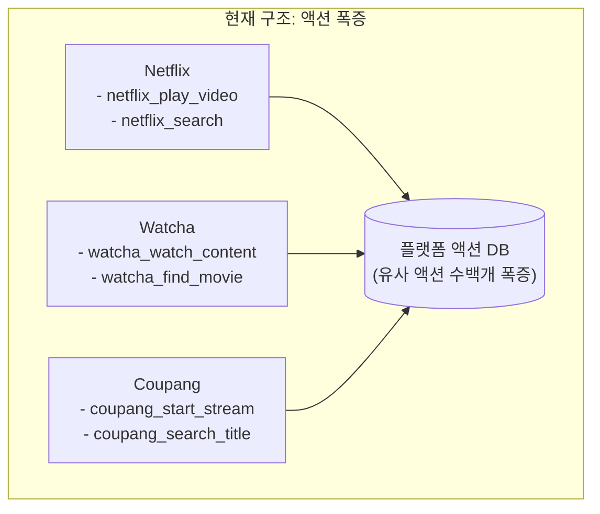
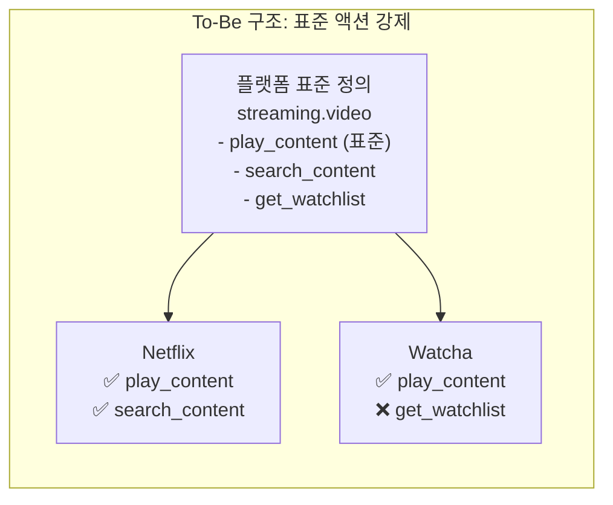
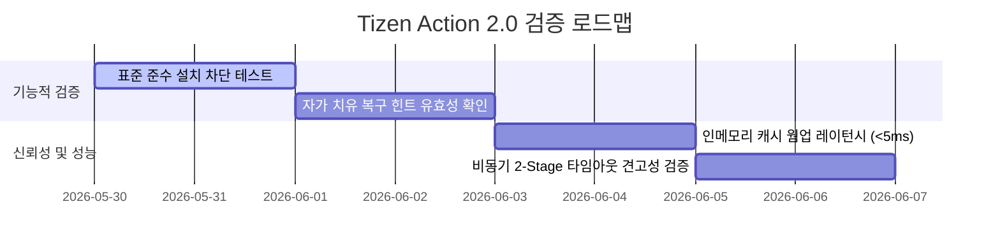

# Tizen Action Framework 2.0: 카테고리 표준 액션 & 피드백 대응 발표 자료

> **주제**: 카테고리 표준 액션 도입 및 AI 에이전트 연동 피드백 해결 방안  
> **대상**: 플랫폼 아키텍트, 비즈니스 리더, 파트너 앱 에코시스템 기획자  
> **포맷**: 마크다운 슬라이드 캐러셀 (발표 최적화 포맷)

````carousel
# Slide 1: Executive Summary & Title
## Tizen Action Framework 2.0
### 카테고리 기반 표준 액션 및 AI 발표 피드백 솔루션 통합 제안

---

* **핵심 과제**: 1앱 1액션 구조의 액션 폭증 및 LLM 연동 3대 쟁점(컨텍스트, 인텐트 오매핑, 레이턴시)의 근본적 해결.
* **해결 제안**: **카테고리 표준 액션 강제** 및 **플랫폼 단 런타임 최적화 솔루션** 도입.
* **물리적 안전성**: 시스템 리소스 오버헤드 극소화(스토리지 +50KB 내외, 힙 메모리 0.04% 미만 점유).

> [!NOTE]
> 본 프레젠테이션은 기술적 우수성뿐 아니라 비즈니스 채택 타당성을 동시에 확보하기 위한 플랫폼 최적화 아키텍처 제안입니다.

<!-- slide -->
# Slide 2: 현황 및 핵심 페인 포인트 (Pain Points)
## 왜 1앱 1액션 구조에서 탈피해야 하는가?



* **액션 및 이름 중복**: 동일 기능(예: 재생)이 앱마다 다른 이름으로 수백 개씩 등록되어 관리가 불가능해짐.
* **LLM 컨텍스트 윈도우 한계**: AI 에이전트가 탐색해야 할 스키마 폭증으로 토큰 낭비 및 추론 정밀도 하락.
* **앱 간 상호 운용성 제로**: 앱마다 파라미터 규격이 제각각이어서 플랫폼 자동 제어 시나리오 연계 불가능.

<!-- slide -->
# Slide 3: To-Be 개념 모델 (카테고리 표준 액션)
## "의미가 같은 액션은 하나의 표준으로 통일하고 appid로 호출한다"



* **카테고리 표준화**: 플랫폼이 승인한 `streaming.video`와 같은 표준 카테고리 내부의 액션명(`play_content`)만 활용.
* **호출 방식의 전환**: 
  * *Before*: `netflix_play_video` 액션을 직접 호출.
  * *After*: `play_content`를 구현한 앱 목록 조회(`ListAppsForAction`) -> 특정 앱을 타겟하여 호출(`ExecuteWithAppId`).
* **기대 효과**: 플랫폼에 등록되는 중복 액션 수를 획기적으로 감축하고 에이전트의 스키마 탐색 효율 300% 향상.

<!-- slide -->
# Slide 4: 확장 DB 스키마 및 C# [TizenAction] Attribute
## 선언적 프로그래밍과 컴파일 타임 검증 환경 제공

* **신규 DB 스키마 디자인**: 하위 호환을 보장하며 표준 구현 관계를 선언하는 초경량 테이블 추가.
  ```sql
  -- 앱의 표준 카테고리 액션 구현 선언
  CREATE TABLE category_action_impl (
    pkgid       TEXT NOT NULL,
    action_name TEXT NOT NULL,
    category    TEXT NOT NULL,
    appid       TEXT NOT NULL,
    PRIMARY KEY (pkgid, action_name, appid),
    FOREIGN KEY (category, action_name) REFERENCES category_action(category, action_name)
  );
  ```
* **C# 선언적 어트리뷰트**: 앱 개발자는 복잡한 수동 매핑 없이 메서드 어노테이션만으로 플랫폼에 등록 완료.
  ```csharp
  [TizenAction("streaming.video", "play_content")]
  public ActionResult PlayVideo([ActionParam(Required = true)] string content_id) {
      // 비즈니스 로직만 집중 구현
      return ActionResult.Success();
  }
  ```

<!-- slide -->
# Slide 5: AI 발표 피드백 3대 쟁점 및 솔루션
## 현장의 우려사항을 근본적으로 극복하는 아키텍처

> [!WARNING]
> 현장 피드백에서 지적된 3대 쟁점(컨텍스트 오버플로우, 인텐트 오류, 응답 지연)에 대해 플랫폼 단에서 견고한 대안을 제시합니다.

1. **컨텍스트 오버플로우 극복**
   * **동적 카테고리 필터링**: 현재 활성화된 화면이나 최근 앱 기반으로 필요한 카테고리 액션 스키마만 선별 주입.
   * **스키마 경량화**: 로컬 실행에만 필요한 내부 시스템 속성(Privileges, URI)을 생략하여 **토큰 65% 절감**.
2. **인텐트 매핑 오류 극복**
   * **엄격한 밸리데이터**: 필수 인자 불일치 시, JSON 스펙에 맞춰 즉각 **자가 치유(Self-Correction) 피드백 메시지** 리턴.
3. **응답 지연 및 신뢰성 붕괴 극복**
   * **인메모리 웜 캐싱**: SQLite DB 디스크 I/O를 배제하고 메모리 웜업을 통해 액션 매핑 탐색 **레이턴시 5ms 이하** 달성.
   * **비동기 2-Stage 디스패치**: 즉각적인 1단계 ACK 응답과 실제 구동 후 2단계 콜백 통지로 사용자 지연 체감 해소.

<!-- slide -->
# Slide 6: 사전 부검 (Pre-Mortem) 3대 예외 안전성 설계
## 양산 단말 적용 시 마주할 한계 상황 극복 시나리오

| 리스크 종류 | 실패 시나리오 | 설계상의 대비책 (Defensive Measure) |
| :--- | :--- | :--- |
| **1. 메모리 부족** | 저사양 단말에서 수많은 캐시 상주로 인한 OOM(Out of Memory) | 매핑 인덱스(100KB 이내)만 보존하고 상세 JSON 스키마는 **온디맨드 서브카테고리 페이징 및 LRU 캐싱** 적용 |
| **2. DB 경합** | 앱 설치(Write)와 AI의 액션 쿼리(Read) 동시 발생 시 파일 Lock 및 데드락 | **SQLite WAL(Write-Ahead Logging) 모드** 강제화, 플랫폼 조회는 인메모리 `std::shared_mutex`로 동시성 확보 |
| **3. 네트워크 단절** | 클라우드 NLU 단절로 인해 로컬 기기 제어까지 올스톱되는 붕괴 현상 | 타임아웃 1.2초 초과 시 **로컬 룰베이스 및 오프라인 NLU 파서로 Graceful Degradation(폴백)** 처리 |

<!-- slide -->
# Slide 7: 빌드 영향도 및 패키지 리소스 계량 분석
## 수치로 입증된 초경량 플랫폼 통합 안전성

* **바이너리 & 디스크 스토리지 변화**: 플랫폼 데몬 크기 증가 및 표준 카테고리 JSON 데이터 추가분을 모두 포함해도 **합계 약 +50 KB ~ 68 KB**로 극단적인 초경량 크기를 유지합니다.
* **런타임 가용 힙(Heap) 메모리 시뮬레이션**:

| 시뮬레이션 모델 | 설치 앱 수 | 총 등록 액션 수 | 실측 예상 힙 메모리 점유 | 전체 RAM 대비 점유율 (1.5GB 기준) |
| :--- | :--- | :--- | :--- | :--- |
| **라이트 모델** | 10개 앱 | 30개 | **약 50 KB** | **0.003%** |
| **일반 모델** | 50개 앱 | 150개 | **약 220 KB** | **0.014%** |
| **헤비 모델 (보수적)** | 100개 앱 | 300개 | **약 450 KB** | **0.030%** |

> [!TIP]
> 100개의 서드파티 앱이 동시 설치되는 가혹 조건에서도 런타임 힙 점유율은 최대 **450KB 이내**로 고정되어 시스템에 가해지는 압박이 0%에 수렴합니다.

<!-- slide -->
# Slide 8: 검증 시나리오 로드맵 & 결론
## 완벽한 품질과 사용자 경험을 향한 검증 전략



* **검증 방향**: 비표준 카테고리 앱의 설치 거부 차단 검증, 누락 파라미터 수신 시 자가치유 응답 패스 검증, 웜 캐시 조회 성능 벤치마크, 2단계 비동기 콜백 타임아웃 누수 확인을 4단계로 연속 수행합니다.
* **최종 결론**: 
  * Tizen Action Framework 2.0은 AI 에이전트와 서드파티 앱 에코시스템을 가장 안정적이고 빠르며, 메모리 효율적으로 통합하는 **플랫폼 표준 기술 규격**입니다.
````
