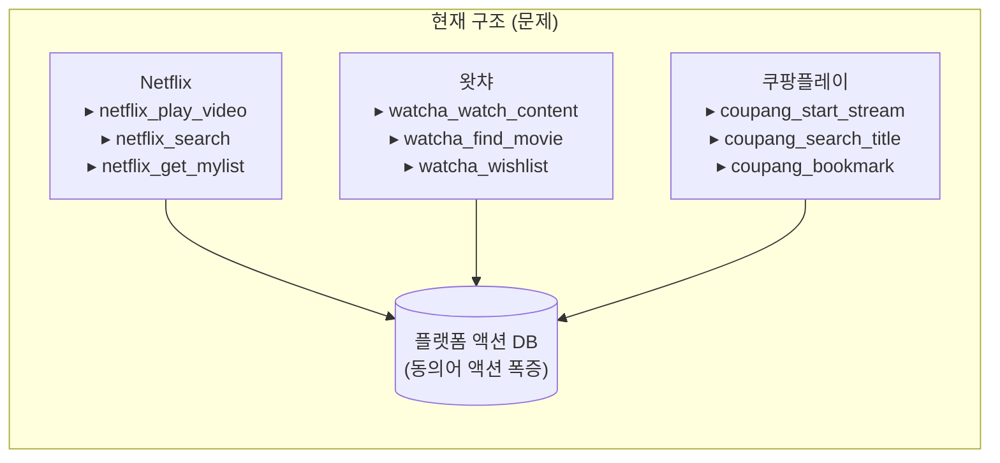
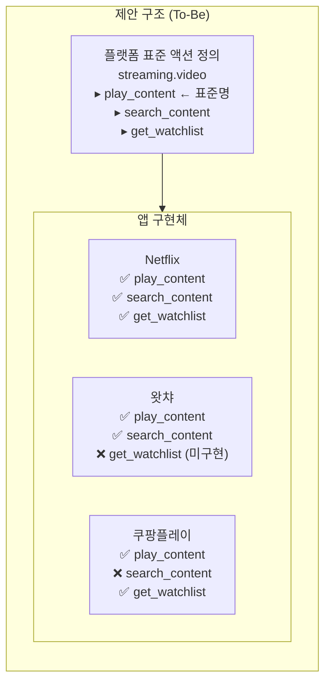
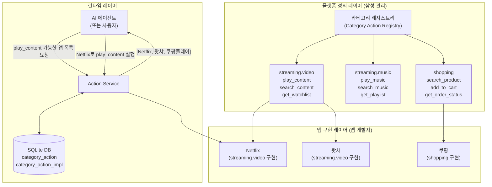
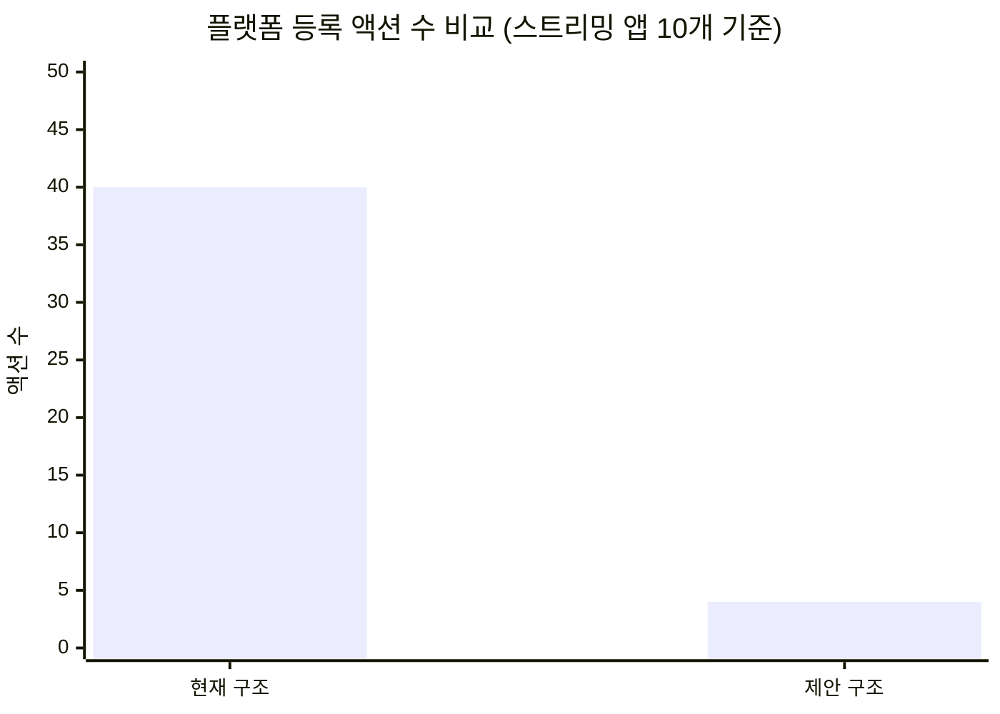
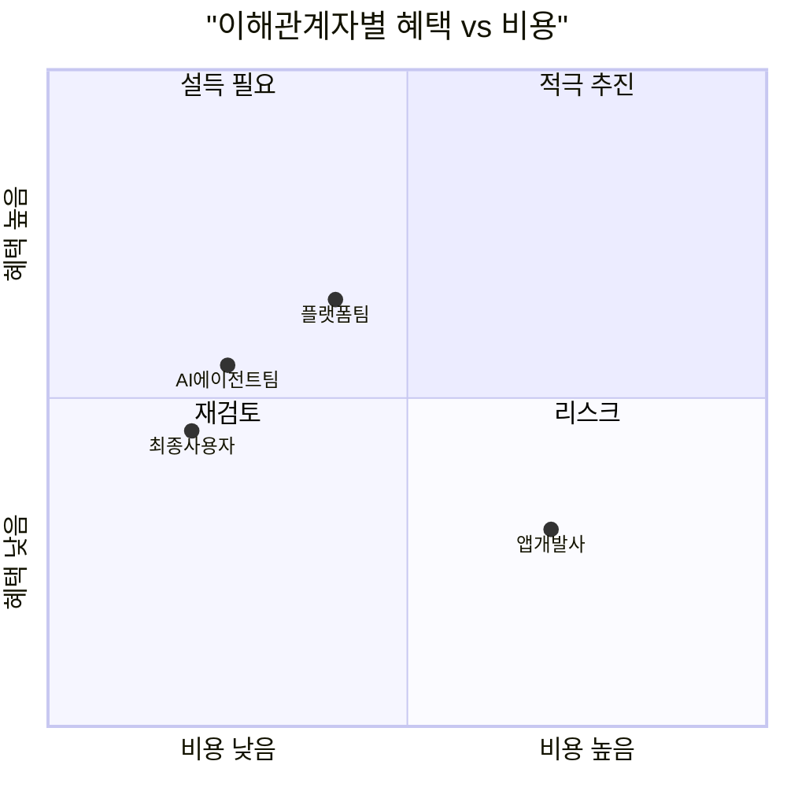
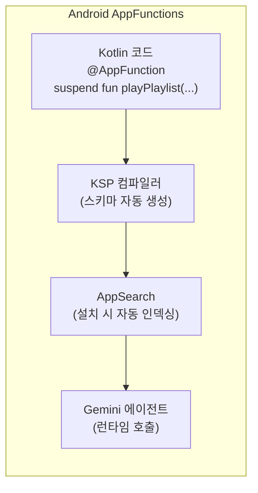
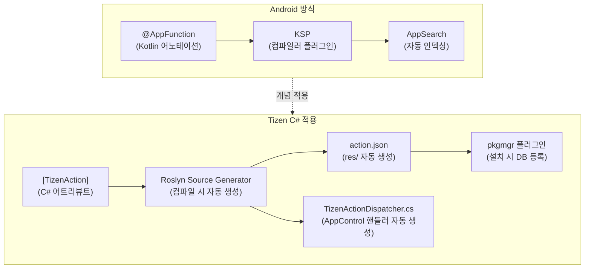
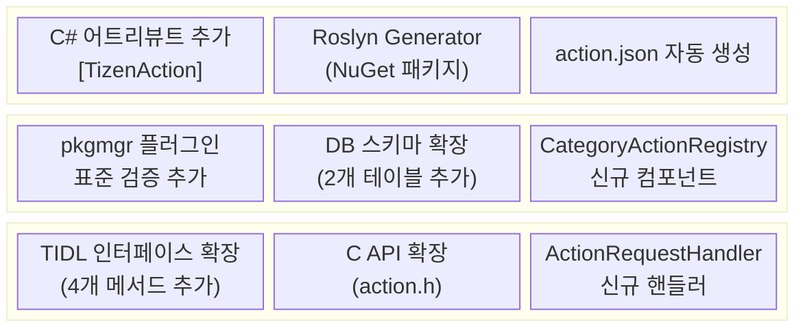
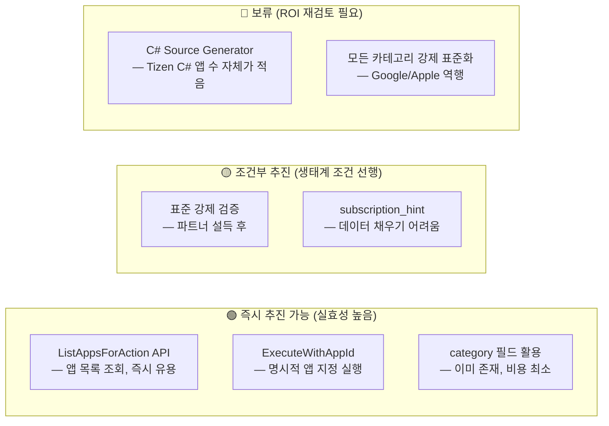

# Tizen Action Framework: 카테고리 기반 표준 액션 도입 보고서

> **문서 유형**: 기획·검토 보고서 (rev.1.1 — 다중 이해관계자 실효성 평가 반영)  
> **작성일**: 2026-05-30  
> **대상**: 플랫폼 아키텍트, 프로젝트 리더  
> **관련 코드베이스**: `tizen-action`

---

## Executive Summary

현재 Tizen Action Framework는 앱마다 액션을 자유롭게 등록하는 구조로,
동일한 기능(예: 콘텐츠 재생)이 앱마다 서로 다른 이름과 스키마로 중복 등록됩니다.

본 보고서는 **앱 카테고리별 표준 액션(Category-Standardized Actions)** 도입을 제안하며,
다중 이해관계자 관점의 실효성 평가를 포함합니다.

| 평가 항목 | 결과 |
|----------|------|
| 기술적 실현성 | ✅ 높음 — `category` 필드 기존 존재, 변경 최소 |
| 개념적 타당성 | ✅ 높음 — AI 에이전트 시대의 올바른 방향 |
| 생태계 채택 가능성 | ⚠️ 낮음 — 앱 파트너 자발적 채택 인센티브 부재 |
| AI 실질 개선 효과 | 🟡 조건부 — 컨텍스트 데이터 품질에 의존 |

> **핵심 결론**: "기술 설계는 잘 됐지만, 생태계 채택 전략 없이는 훌륭한 빈 표준이 될 위험이 있다."

---

## 1. 현황 및 문제 인식

### 1.1 현재 동작 방식

앱이 설치될 때, 앱 패키지 내부의 JSON 파일(액션 스키마)이 플랫폼 DB에 등록됩니다.
이후 AI 에이전트나 다른 앱이 이 액션을 이름으로 조회하고 실행할 수 있습니다.



### 1.2 핵심 문제점

> [!WARNING]
> 현재 `category` 필드가 DB와 코드 모두에 이미 존재하지만, **실제로 전혀 활용되지 않고 있습니다.** 이것이 이번 제안의 핵심 출발점입니다.

| # | 문제 | 영향 |
|---|------|------|
| 1 | **액션 이름 중복** | `play_content` / `watch_video` / `start_stream` — 의미는 동일, 이름만 다름 |
| 2 | **플랫폼 확장성 한계** | 앱이 늘수록 액션 수가 선형으로 증가, 관리 불가 |
| 3 | **AI 에이전트 혼선** | LLM이 "어떤 스트리밍 앱으로 영화 틀어줘"를 처리하려면 의미 동일한 수십 개 액션을 비교해야 함 |
| 4 | **앱 간 상호 운용 불가** | 같은 기능이지만 인터페이스가 달라 자동화/통합 불가 |
| 5 | **개발자 표준 부재** | 앱 개발자가 어떤 액션을 만들어야 하는지 가이드 없음 |

---

## 2. 제안: 카테고리 기반 표준 액션

### 2.1 핵심 개념

> **"같은 카테고리의 앱은 동일한 표준 액션을 구현한다. 플랫폼은 `action_name`으로 구현 앱 목록을 반환하고, 호출자가 `appid`로 특정 앱을 선택하여 실행한다."**



### 2.2 호출 시나리오 변화

**Before**: 액션 이름으로 단 하나의 앱을 직접 지정해야 함

```
action_client_execute(client, '{"name":"netflix_play_video","params":{"id":"tt123"}}')
```

**After**: 표준 액션으로 구현 앱 목록 조회 → 사용자/AI가 앱 선택 → 실행

```
1. action_client_foreach_apps_for_action("play_content")
   → [Netflix, 왓챠, 쿠팡플레이]

2. action_client_execute_with_appid("play_content", "com.netflix.tizen", params)
```

---

## 3. 제안 구조의 전체 그림



---

## 4. 기대 효과 및 현실적 제약

### 4.1 정량적 효과 (이론)



| 지표 | 현재 (As-Is) | 제안 (To-Be) |
|------|-------------|-------------|
| 스트리밍 앱 10개 × 액션 4개 | **40개 액션** | **4개 표준 액션** |
| 신규 앱 추가 시 증가량 | +4개 | **+0개** (기존 표준 재사용) |
| 개발자 정의 필요 항목 | 액션명 + 스키마 전체 | appid만 추가 |

### 4.2 이해관계자별 실효성



| 이해관계자 | 입장 | 핵심 이유 |
|-----------|------|----------|
| **플랫폼팀** | 🟡 중립 | 기술 비용 낮으나, 문제 시급성 불명확 |
| **AI 에이전트팀** | 🟡 조건부 | 40→4개 감소 효과가 LLM에 유의미한지 미검증 |
| **앱 개발사** | 🔴 소극적 | 자발적 채택 인센티브 없음, 오히려 경쟁사와 동일 버킷에 묶임 |
| **최종 사용자** | 🟡 조건부 | 구독 컨텍스트 데이터 품질에 전적으로 의존 |

> [!WARNING]
> Google과 Apple 모두 앱 액션 프레임워크에서 **자유 정의 방식**을 선택했습니다.  
> 표준 강제가 장기적으로 생태계 혁신을 제약할 수 있다는 점도 고려해야 합니다.

---

## 5. Android AppFunctions 비교 분석

### 5.1 Google의 방향성

Google은 2025~2026년에 Android 16과 함께 **AppFunctions**를 발표했습니다.
이는 AI 에이전트(Gemini)가 앱 내부 기능을 직접 호출할 수 있도록 하는 프레임워크로,
MCP(Model Context Protocol)의 온디바이스 버전으로 위치합니다.



### 5.2 Tizen vs Android 비교

| 항목 | Android AppFunctions | Tizen 현재 | Tizen 제안 |
|------|---------------------|-----------|-----------|
| **스키마 정의** | 코드 어노테이션 (`@AppFunction`) | JSON 파일 수동 작성 | JSON 파일 (C#은 어트리뷰트) |
| **스키마 생성** | KSP 자동 생성 | 수동 | Roslyn Generator 자동 생성 |
| **카테고리 표준화** | ❌ 없음 (자유 정의) | ❌ 있으나 미활용 | **✅ 플랫폼 강제** |
| **AI 연동** | Gemini 직접 호출 | MCP 호환 JSON-RPC | MCP 호환 JSON-RPC |
| **appid 라우팅** | ❌ 없음 | 가능 (수동) | **✅ 표준화된 API** |
| **C# 지원** | ❌ 없음 | ❌ 없음 | **✅ 신규 제안** |
| **IPC** | Binder / AIDL | RPC Port / TIDL | RPC Port / TIDL |

> [!IMPORTANT]
> **Tizen 제안의 차별점**: Android AppFunctions는 카테고리 표준화가 없어 앱마다 자유롭게 함수를 정의합니다. Tizen은 이보다 한 단계 더 나아가 **플랫폼이 카테고리별 표준 액션을 정의하고 앱이 이를 구현**하는 더 강력한 거버넌스 구조를 제안합니다.

### 5.3 Android AppFunctions → Tizen C# 적용 방향



**C# 개발자 경험 예시**:

```csharp
// 개발자가 작성하는 코드 (전부)
[TizenAction(Category = "streaming.video", ActionName = "play_content")]
public async Task<ActionResult> PlayContent(
    [ActionParam(Description = "컨텐츠 ID", Required = true)] string contentId
)
{
    await _player.Play(contentId);
    return ActionResult.Success();
}

// ↓ 빌드 시 자동 생성됨
// - res/action_play_content.json
// - TizenActionDispatcher.cs (AppControl 수신 처리)
```

---

## 6. 구현 영향 범위 개요

### 6.1 계층별 변경 요약



### 6.2 하위 호환성

> [!NOTE]
> 기존의 카테고리 없는 자유 액션은 **변경 없이 그대로 동작**합니다. 표준 카테고리를 사용하는 신규 액션에만 새로운 검증 로직이 적용됩니다.

---

## 7. 결론 및 권고사항

### 7.1 실효성 있는 부분과 없는 부분



### 7.2 수정된 권고 우선순위

| 순위 | 항목 | 방식 | 이유 |
|------|------|------|------|
| 🥇 1 | **`ListAppsForAction` + `ExecuteWithAppId` API 추가** | 즉시 구현 | 강제 표준 없이도 즉시 가치 제공 |
| 🥈 2 | **삼성 1st-party 앱 파일럿** | 내부 적용 후 효과 검증 | 파트너 설득 전 AI 추천 향상 데이터 확보 |
| 🥉 3 | **4대 인센티브 전략 동시 설계** | 기술 구현과 병행 | AI 추천 우선순위 + 스토어 노출 + 개발 자동화 + 파트너십 인증 체계 수립 |
| 4 | **표준 강제 검증** | 파트너 합의 후 | 생태계 채택률 50% 이상 확보 후 단계적 전환 |
| 5 | **C# Source Generator** | 중장기 | Tizen C# 생태계 성숙 후 |

### 7.3 핵심 메시지 (최종)

> [!IMPORTANT]
> **기술보다 생태계 전략이 먼저입니다. 인센티브 없는 표준 강제는 파트너 이탈을 부릅니다.**

1. **지금 당장**: `category` 필드 + `ListAppsForAction` API — 강제 표준 없이도 즉시 가치 제공
2. **단기**: 삼성 1st-party 앱 파일럿으로 AI 추천 향상 효과 데이터 확보 → 파트너 설득 근거
3. **중기**: 4대 인센티브 전략 병행 도입으로 자발적 채택 유도
   - **AI 추천 우선순위 부스팅**: 표준 구현 앱 = `priority_score` 가점, AI가 먼저 제안
   - **Store 노출 혜택**: 홈 화면 우선 배치 + 'AI 최적화' 배지
   - **개발 비용 제거**: Roslyn Generator가 어트리뷰트 1줄로 전체 처리
   - **파트너십 인증 체계**: Basic → Advanced → Premier 등급별 마케팅 혜택
4. **주의**: 강제 표준화는 채택률 50% 이상 확보 후, 파트너 합의를 거쳐 단계적으로

> [!NOTE]
> **경쟁 희석 우려 해결**: 표준 내 확장 파라미터 허용 + 사용자 선호 앱 학습(AI가 한번 선택된 앱을 자동 재선택)으로 오히려 충성 유저 고정 효과를 제공합니다.

---

## 관련 문서

| 문서 | 내용 |
|------|------|
| [상세 설계서](detailed_component_design.md) | 코드 레벨 6대 컴포넌트 상세 설계 |
| [피드백 솔루션 설계](solution_feedback_issues.md) | AI 3대 피드백 대응 및 리소스 분석 |
| [**인센티브 전략 설계서**](developer_incentive_strategy.md) | 앱 개발사 자발적 채택 유도 4대 전략 전체 설계 |
