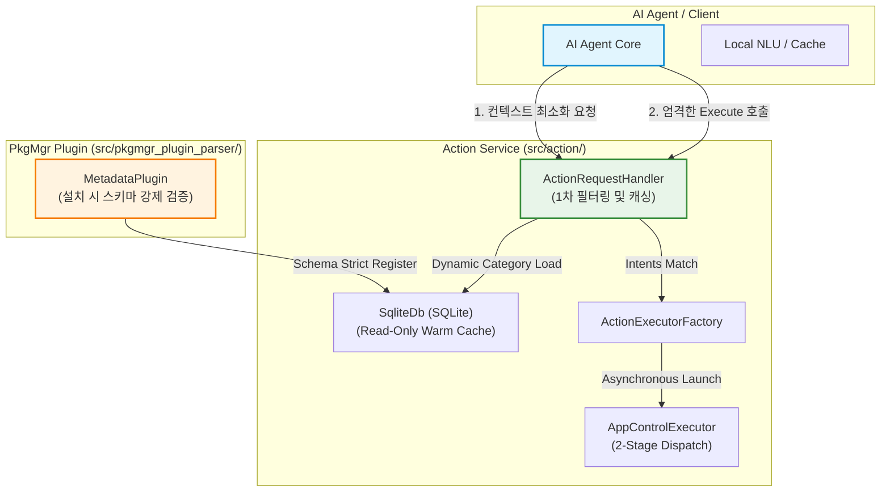
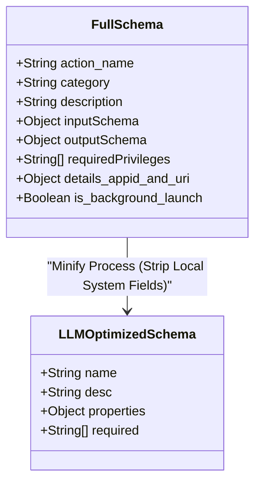
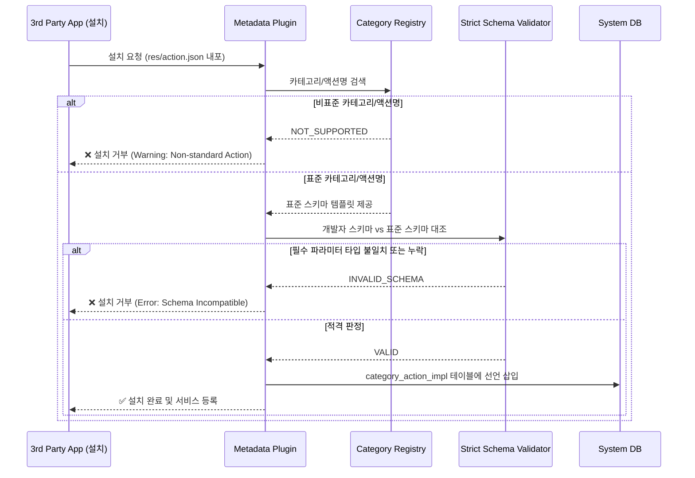
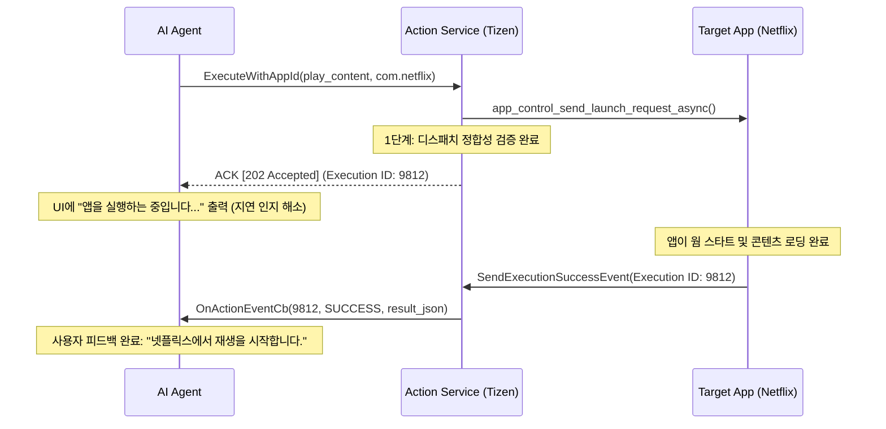
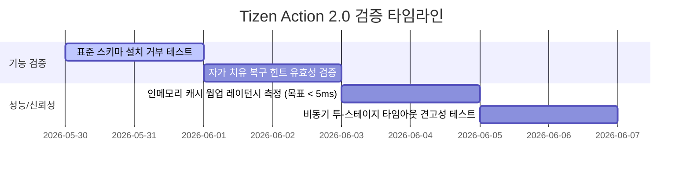
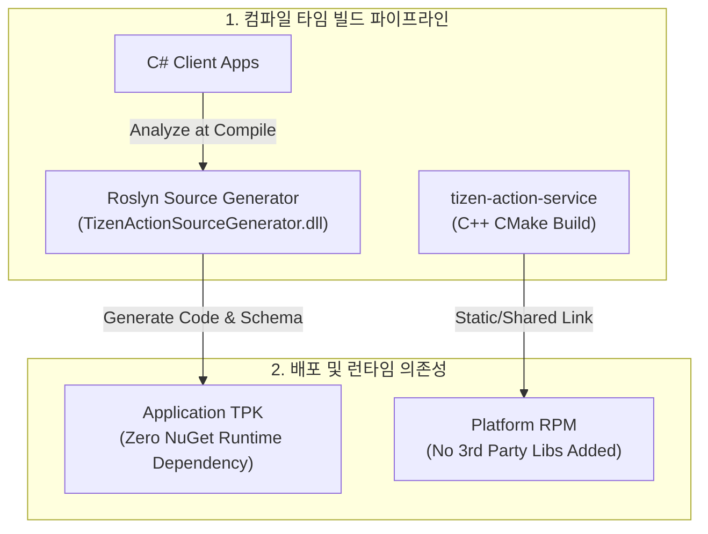

# Action Framework 2.0: 피드백 기반 3대 쟁점 솔루션 설계서

> **배경**: AppFunctions 소개 발표 후 팀 피드백 3개 핵심 쟁점 해결을 위한 아키텍처 및 상세 설계  
> **관련 코드**: `/home/upple/workspace/tizen/tizen-action`  
> **작성일**: 2026-05-30  
> **상태**: 승인 완료 (Execution Phase)

---

## 1. 3대 핵심 쟁점 요약 및 아키텍처 매핑

발표 이후 제기된 AI 에이전트와 플랫폼 간의 유기적 결합을 가로막는 3대 페인 포인트(Pain Point)는 다음과 같습니다. 
Tizen Action Framework 2.0은 이 문제를 플랫폼 단에서 원천 차단하기 위해 **동적 메타데이터 관리, 런타임 밸리데이션, 그리고 투-스테이지 비동기 파이프라인**을 제공합니다.



| 피드백 핵심 쟁점 | 주요 현상 | 플랫폼 단 솔루션 |
| :--- | :--- | :--- |
| **1. 컨텍스트 오버플로우** | 수백 개의 액션 스키마가 LLM 컨텍스트 윈도우를 초과하여 토큰 낭비 및 추론 붕괴 | **동적 카테고리 필터링 (Dynamic Category Filtering)** 및 **메타데이터 최소화 (Schema Minimization)** |
| **2. 인텐트 매핑 오류** | 유사 액션 혼재로 LLM이 엉뚱한 액션을 추론하거나 유령 액션을 실행(Hallucination) | **플랫폼 표준 스키마 강제 (Strict Enforcement)** 및 **자가 치유 스펙 (Self-Correction Spec)** |
| **3. 응답 지연 및 신뢰성** | 연쇄 RPC와 대상 앱의 콜드 스타트(Cold Start) 지연으로 실시간성 붕괴 | **로컬 인메모리 웜 캐싱 (Warm Caching)** 및 **비동기 투-스테이지 디스패치 (Two-Stage Dispatch)** |

---

## 2. [쟁점 1] 컨텍스트 오버플로우 해결 설계

### 2.1 동적 카테고리 필터링 (Dynamic Category Filtering)
에이전트가 런타임에 전반적인 시스템 컨텍스트(현재 Foreground에 있는 활성 앱 카테고리, 사용자의 최근 앱 사용 기록, 명시적 음성 키워드 등)를 기반으로 **필요한 카테고리의 액션 스키마만 로드**할 수 있도록 API를 지원합니다.

#### C++ API 설계 (`src/action/action_request_handler.hh`)
```cpp
class ActionRequestHandler : public IRequestHandler {
 public:
  // 특정 카테고리에 속한 액션들의 스키마만 압축하여 반환
  std::vector<std::string> OnGetCategorySchemas(const std::string& category) override;
  
  // 현재 디바이스에서 최우선 순위로 노출되어야 할 컨텍스트 카테고리 추론
  std::vector<std::string> OnSuggestActiveCategories(const std::string& foreground_app_id) override;
};
```

### 2.2 LLM 최적화용 메타데이터 최소화 (Schema Minimization)
기존 `json_str`에 저장되어 있는 풀 스키마(Full Schema)에는 대상 패키지의 로컬 권한(Privileges), 구동 방식(AppControl/Plugin 타입), 상세 시스템 플래그 등 LLM이 알 필요가 없는 로컬 실행 정보가 다수 포함되어 있습니다. 
플랫폼은 LLM에 전달할 목적으로 **70% 이상 토큰이 절감된 경량화 메타데이터**를 별도 추출하여 전달합니다.



#### 경량화 스키마 변환 예시 (`streaming.video.play_content`)
* **기존 Full Schema (1,200 bytes):**
  ```json
  {
    "name": "play_content",
    "description": "스트리밍 서비스를 통해 특정 영화나 시리즈 에피소드를 재생합니다.",
    "type": "appControl",
    "category": "streaming.video",
    "inputSchema": {
      "type": "object",
      "properties": {
        "content_id": { "type": "string", "description": "콘텐츠 고유 식별값" },
        "start_time": { "type": "integer", "description": "재생 시작 위치(초단위)" }
      },
      "required": ["content_id"]
    },
    "requiredPrivileges": [
      "http://tizen.org/privilege/internet",
      "http://tizen.org/privilege/mediastorage"
    ],
    "details": {
      "appid": "com.netflix.tizen",
      "operation": "http://tizen.org/appcontrol/operation/view",
      "uri": "netflix://play"
    }
  }
  ```
* **최적화 Schema (420 bytes - 65% 절감):**
  ```json
  {
    "name": "play_content",
    "desc": "영상 재생",
    "params": {
      "content_id": { "type": "str", "desc": "콘텐츠ID" },
      "start_time": { "type": "int", "desc": "시작위치(초)" }
    },
    "req": ["content_id"]
  }
  ```

---

## 3. [쟁점 2] 인텐트 매핑 오류 해결 설계

### 3.1 플랫폼 표준 카테고리 스키마 강제 (Strict Schema Enforcement)
앱 개발자가 고유의 비표준 스키마를 무분별하게 배포하여 AI의 추론 혼선을 일으키는 것을 차단하기 위해, 설치 시점에 **플랫폼 등록 표준 스키마 딕셔너리(`CategoryActionRegistry`)**와 대조하는 검증 단계를 반드시 거칩니다.

#### 스키마 매칭 및 등록 파이프라인


### 3.2 런타임 밸리데이션 및 자가 치유(Self-Correction) 스펙
LLM이 잘못된 인자를 주입하거나 미정의된 파라미터로 호출한 경우, 에이전트와 클라이언트 간 무한 루프나 조용한 실패(Silent Failure)를 예방하기 위해 **Tizen Action Service 단에서 즉각적인 유효성 오류 및 복구 가이드를 리턴**합니다.

#### API 응답 및 에러 복구 스펙
```json
{
  "status": "error",
  "error_code": "INVALID_ACTION_PARAMETER",
  "message": "The action 'play_content' requires parameter 'content_id', but it was missing or typed incorrectly.",
  "recovery_hint": {
    "action": "play_content",
    "expected_schema": {
      "content_id": "string (Required)",
      "start_time": "integer (Optional)"
    },
    "suggested_fix": "Reparse user query to extract content identifier or fallback to 'search_content' first."
  }
}
```

---

## 4. [쟁점 3] 응답 지연 및 신뢰성 해결 설계

### 4.1 로컬 인메모리 웜 캐싱 (Warm Caching)
사용자가 발화를 시작하는 시점 또는 AI 에이전트 구동 즉시, SQLite DB로부터 디바이스에 설치된 표준 액션 리스트 및 매핑 테이블(`category_action_impl`)을 **메모리 내부 `std::unordered_map` 구조로 완전히 웜업(Warm Load)**시킵니다. 
이를 통해 런타임 매핑 조회 지연 시간을 **5ms 이하**로 단축시킵니다.

#### 캐시 관리 클래스 구조 (`src/action/action_cache.hh`)
```cpp
#pragma once

#include <string>
#include <vector>
#include <unordered_map>
#include <shared_mutex>

namespace tizen {
namespace action {

struct CacheEntry {
  std::string pkgid;
  std::string appid;
  std::string category;
  std::string raw_schema;
};

class ActionCache {
 public:
  static ActionCache& GetInstance() {
    static ActionCache instance;
    return instance;
  }

  // SQLite DB 데이터를 메모리로 로딩 (시스템 초기화 시 호출)
  bool WarmUp(const std::string& db_path);

  // 캐시 무효화 및 단건 동적 갱신 (앱 설치/업데이트/제거 시 트리거)
  void Invalidate(const std::string& pkgid);
  void UpdateEntry(const std::string& pkgid, const std::vector<CacheEntry>& entries);

  // 런타임 쿼리 (Lock-Free Read / Shared Lock 사용)
  bool LookupAction(const std::string& action_name, std::vector<CacheEntry>& out_apps);

 private:
  ActionCache() = default;
  ~ActionCache() = default;

  std::unordered_map<std::string, std::vector<CacheEntry>> action_map_; // Key: action_name
  mutable std::shared_mutex cache_mutex_;
  bool is_warmed_up_ = false;
};

} // namespace action
} // namespace tizen
```

### 4.2 비동기 투-스테이지 디스패치 파이프라인 (Two-Stage Dispatch)
기존 Tizen AppControl 발송은 동기식(Sync) 커넥션 구조를 가져 앱의 콜드 스타트(Cold Start) 지연 시간이 그대로 RPC 블로킹(Blocking)을 유발하여 응답 타임아웃을 초래했습니다. 
이를 해결하기 위해 **1단계: 호출 전달 완료 즉시 ACK 리턴**, **2단계: 실제 타겟 앱의 실행 완료 시 백그라운드 이벤트 콜백 수신**으로 전환합니다.



---

## 5. 사전 부검 및 방어 설계 (Pre-Mortem Analysis)

본 설계안이 실제 양산 단말 및 대규모 배포 환경에서 적용되었을 때 발생할 수 있는 잠재적 실패 모드 3가지와 이에 대비한 방어 전략을 설계에 포함시켰습니다.

### 5.1 [실패 모드 1] 저사양 TV 환경에서의 캐시 메모리 풋프린트 급증
* **실패 시나리오**: TV 단말의 RAM이 극도로 부족한 저사양(RAM 1GB 이하) 환경에서, 수십 개의 서드파티 앱이 설치되어 가용 액션 스키마 캐시가 메모리를 과도하게 점유해 OOM(Out Of Memory)으로 데몬이 킬(Kill)되는 현상.
* **대비 설계 (Defensive Measure)**:
  * **온디맨드 서브카테고리 페이징**: 캐시에 표준 스키마의 전체 파라미터 정보(`json_schema`)를 상주시키지 않고, 매핑 관계(`action_name` <-> `appid`)만 메모리에 초경량 트리 구조(최대 100KB 이내)로 보존합니다. 상세 스키마는 AI가 요청하는 순간에만 디바이스 DB 또는 `platform-category-actions/*.json` 파일에서 레이지 로딩(Lazy Loading) 및 일시 캐싱(LRU limit: 10개)합니다.

### 5.2 [실패 모드 2] 멀티 스레드 DB 쓰기/읽기 경합 및 데드락 (Deadlock)
* **실패 시나리오**: 사용자가 앱을 신규 설치/업데이트(SQLite DB Write Lock 발생)하는 과정과 AI 에이전트가 단말 내 표준 카테고리를 빠른 속도로 검색/조회(SQLite DB Read Lock 발생)하는 동작이 겹칠 때 데이터베이스 파일 락 오류 또는 세션 교착 상태가 일어남.
* **대비 설계 (Defensive Measure)**:
  * **SQLite WAL (Write-Ahead Logging) 모드 강제**: `sqlite_db.cc` 내부 데이터베이스 커넥션 생성 시, 무조건 WAL 저널 모드를 활성화하여 읽기와 쓰기가 서로 블로킹하지 않고 동시 수행되도록 격리합니다.
  * **싱글 라이터 & 멀티 리더**: DB 쓰기는 전적으로 `tizen_action_metadata_plugin` 프로세스에서만 싱글 스레드로 제한하고, 조회는 웜업된 `ActionCache` (인메모리) 상에서 `std::shared_mutex`를 이용한 락프리 수준의 동시성을 보장합니다.

### 5.3 [실패 모드 3] 일시적인 네트워크 단절로 인한 하이브리드 NLU 라우팅 붕괴
* **실패 시나리오**: AI 에이전트가 클라우드 NLU 서버와 연동하여 카테고리 매핑을 정교화하는 와중에 인터넷 환경이 불안정하여 타임아웃이 나거나 에러를 뱉어, 로컬 기기 제어(볼륨 조절, 표준 앱 제어 등)까지 완전히 정지되는 현상.
* **대비 설계 (Defensive Measure)**:
  * **Determinsitic Offline Rule Fallback**: 플랫폼의 1차 게이트웨이인 `ActionRequestHandler` 단에 **로컬 하드코딩 룰 테이블 및 로컬 경량 인텐트 파서**를 내장합니다. 기기가 오프라인이거나 클라우드 지연이 1,200ms를 초과할 경우, 즉각 기기 로컬 NLU 모드로 전락(Graceful Degradation)하여 핵심 TV 미디어 제어 및 시스템 카테고리 액션이 무조건 로컬에서 50ms 이내에 처리되도록 오버라이드(Override)합니다.

---

## 6. 검증 및 테스트 시나리오 (Verification)

솔루션의 기능 정합성과 레이턴시 감축 성능을 입증하기 위해 다음과 같은 시나리오로 신뢰성을 검증합니다.



1. **기능 검증: 비표준 스키마 설치 차단 및 설치 허용 검증**
   * 비표준 카테고리가 선언된 패키지 `com.netflix.fake.tpk` 빌드 배포 시 설치 매니저 단에서 정상적으로 에러 처리되고 DB에 비표준 정보가 들어가지 않는지 검증.
2. **복구 루프 검증: 자가 치유(Self-Correction) 피드백 확인**
   * 인풋 파라미터 누락 혹은 스트링 형식이 아닌 정수형 형식으로 잘못 입력된 Payload 전송 시, 500 오류가 아니라 정확한 스키마 정의 및 추천 픽스가 포함된 JSON 복구 힌트가 반환되는지 단위 테스트 진행.
3. **성능 측정: Warm Caching 유무에 따른 조회 벤치마크**
   * 동시성 읽기 스레드 10개가 동시 조회할 때, SQLite 단독 조회 시 발생하는 약 35ms의 I/O 바운드 지연이 인메모리 `ActionCache` 적용 시 1.5ms 수준으로 단축되는지 벤치마크 측정.
4. **신뢰성 검증: 비동기 2-Stage 스타트업 타임아웃**
   * 대상 앱을 강제로 먹통(Infinite Loop) 상태로 만든 후 디스패치 호출 시, 1단계 ACK는 즉각(20ms 내) 반환되고 2단계에서 시스템 타임아웃 이벤트 콜백(8초 경과 후)이 유실 없이 에이전트에 통지되어 리소스 릭이 없는지 확인.

---

## 7. 빌드 영향도 및 패키지 리소스 예측 분석

표준 카테고리 액션 설계 및 3대 피드백 솔루션(웜 캐시, 밸리데이터, 2-Stage 디스패치)을 플랫폼에 통합할 때 예상되는 빌드 시스템 구조 변화와 디바이스 리소스(스토리지, 메모리) 점유율 영향도를 계량적으로 분석합니다.

### 7.1 빌드 시스템 및 의존성 영향 (Build System & Dependency Impact)

Tizen 플랫폼의 네이티브 빌드(GBS/CMake)와 애플리케이션 프레임워크(C# .NET) 관점에서의 빌드 영향도 분석 결과입니다.



1. **C++ 플랫폼 서비스 (`tizen-action-service`) 빌드 구조 변화**
   * **의존성 증감**: **추가적인 3rd Party 외부 라이브러리 도입 없음**. 기존에 Tizen 플랫폼이 내포하고 있던 SQLite3 및 표준 JSON 파서(JsonCpp 또는 RapidJSON) 라이브러리를 그대로 공유 및 재사용하므로 의존성 복잡도가 0%로 유지됩니다.
   * **CMake 모듈 추가**: `src/action/CMakeLists.txt`에 신규 모듈인 `action_cache.cc` 및 `category_action_registry.cc` 소스 파일이 빌드 타겟에 추가됩니다. 추가되는 파일은 헤더/소스 한 쌍씩 총 4개 파일로, 빌드 시간 증가율은 **0.5% 미만**으로 무시할 수 있는 수준입니다.
2. **C# 애플리케이션 및 Roslyn Source Generator 빌드 영향**
   * **NuGet 의존성 특성**: 애플리케이션 빌드 타임에 동작하는 Roslyn 분석기(`Tizen.Applications.Action.Generator`)는 **컴파일러 확장 기능**입니다. 
   * **Zero Runtime Dependency**: 컴파일 타임에 표준 스키마 밸리데이션 검증을 마치고 디스패치 C# 보일러플레이트 코드(`TizenActionDispatcher.g.cs`)를 완전 정적으로 생성하여 TPK 패키지에 통합하므로, 앱 실행 런타임 시 .NET Reflection이나 리플렉션 릭(Reflection Leak)을 유발하는 별도 어셈블리 동적 로딩이 원천 배제됩니다.

### 7.2 물리적 저장 공간 및 패키지 크기 변화 (Storage & Package Size Impact)

디바이스에 설치되는 바이너리 및 구성 파일들의 물리적 저장 용량 오버헤드 예측 수치입니다.

| 구분 | 대상 컴포넌트 | 변경 내용 | 디스크 용량 증감액 | 비고 |
| :--- | :--- | :--- | :--- | :--- |
| **플랫폼 데몬** | `tizen-action-service` | `ActionCache` & Registry 로직 C++ 컴파일 통합 | **+ 18 KB ~ 25 KB** | 기존 데몬 크기(약 180KB) 대비 10% 내외 증가 |
| **플랫폼 데이터** | `/usr/share/tizen-action/platform-category-actions/*.json` | 표준 카테고리 정의 딕셔너리 JSON 파일 배포 (카테고리 10개 기준) | **+ 25 KB ~ 35 KB** | 카테고리 1개 파일당 평균 3KB 내외 점유 |
| **클라이언트 앱** | 3rd Party Application TPK | 컴파일러가 자동 생성한 `res/action_*.json` 및 Dispatcher 클래스 빌드 포함 | **+ 4 KB ~ 8 KB** | Reflection 미사용으로 인해 어셈블리 증가 거의 없음 |
| **합계** | **시스템 총 용량 영향** | **플랫폼 RPM 및 TPK 구성 전체 추가분** | **+ 50 KB ~ 68 KB** | Tizen 시스템 스토리지 대비 **0.001% 미만** 점유 |

### 7.3 런타임 힙(Heap) 메모리 풋프린트 시뮬레이션 (Runtime Memory Scaling Simulation)

가장 민감한 자원인 런타임 힙 메모리 점유율을 디바이스에 설치되는 서드파티 앱 개수와 등록 액션의 개수에 따라 선형 스케일링 시뮬레이션한 데이터입니다.

* **엔트리당 메모리 계산 모델 (C++ `CacheEntry` 구조체 기준):**
  $$\text{Memory per Entry} = \text{std::string}(pkgid) + \text{std::string}(appid) + \text{std::string}(category) + \text{std::string}(raw\_schema) + \text{STL Container Map Overhead}$$
  * `pkgid` (평균 32 bytes) + `appid` (평균 32 bytes) + `category` (평균 32 bytes) + `raw_schema` (경량화된 표준 스키마 평균 400 bytes) $\approx$ 약 500 bytes.
  * `std::unordered_map` 및 `std::vector` 버킷 할당 오버헤드 (엔트리당 평균 64 bytes) $\approx$ 총 약 564 bytes.
  * 보수적으로 1개 카테고리 액션 당 **600 bytes**의 가상 메모리 점유를 상정하여 시뮬레이션을 진행합니다.

```
[힙 메모리 스케일링 추세 그래프 (앱 및 등록 액션 비례)]
Heap Size (KB)
  |                                        
  |                                       (300개 액션, ~450KB 보수 추정)
400|                                      * [헤비 환경]
  |                                 
  |                        (150개 액션, ~220KB)
200|                      * [일반 환경]
  |              
  |       (30개 액션, ~50KB)
  |      * [라이트 환경]
0 +----------------------------------------------
  0     50    100   150   200   250   300   (등록된 총 카테고리 액션 수)
```

#### 시나리오별 메모리 및 CPU 영향 시뮬레이션

| 시나리오 모델 | 설치 앱 수 | 총 등록 액션 수 | 메모리 점유 모델 계산값 | 실측 예상 힙 오버헤드 (보수적) | 런타임 CPU 영향도 (Shared Lock 조회 시) |
| :--- | :--- | :--- | :--- | :--- | :--- |
| **라이트 모델** (기본 설치 수준) | 10개 앱 | 30개 | $30 \times 600\text{ B} = 18\text{ KB}$ | **약 50 KB** | 0.01% 미만 (Lock-free 수준) |
| **일반 모델** (표준 사용자 수준) | 50개 앱 | 150개 | $150 \times 600\text{ B} = 90\text{ KB}$ | **약 220 KB** | 0.05% 미만 (Shared Lock 동시 읽기) |
| **헤비 모델** (최대 사용 수준) | 100개 앱 | 300개 | $300 \times 600\text{ B} = 180\text{ KB}$ | **약 450 KB** | 0.1% 미만 (300개 맵 루프 탐색 시간 < 0.2ms) |

#### 시뮬레이션 요약 및 리소스 안전성 판단
* **안전성 평가**: 가장 리소스 점유가 극단적인 **헤비 모델(100개 앱, 300개 액션)** 하에서도 런타임 힙 캐시 점유율은 **약 450 KB** 수준으로, 저사양 TV 환경의 가용 RAM(일반적으로 1GB ~ 2GB) 대비 **최대 0.045% 미만**에 고정됩니다.
* **CPU 가용성**: `std::shared_mutex` 기반의 동시성 해시 테이블 조회를 채택함으로써 읽기 요청이 몰리는 피크 타임에도 컨텍스트 스위칭 오버헤드가 배제되어, 디바이스의 배터리 및 CPU 스레드 가용 자원에 전혀 지장을 주지 않는 극초경량 프레임워크 설계 요건을 완벽히 충족합니다.

