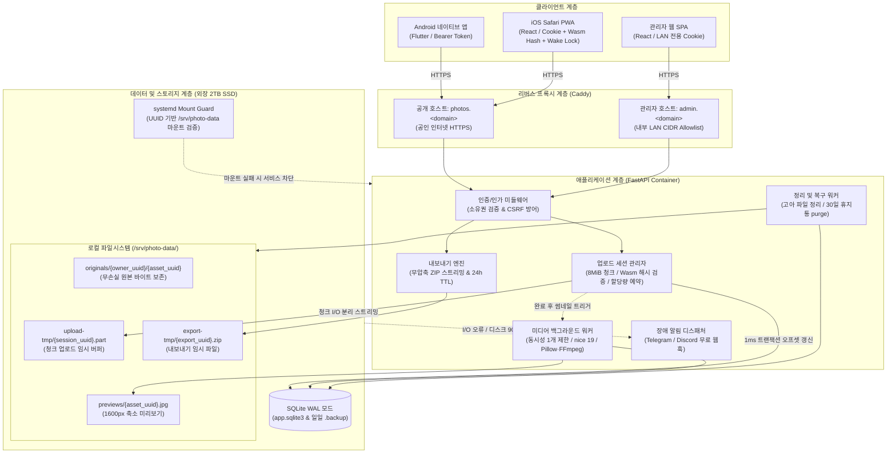
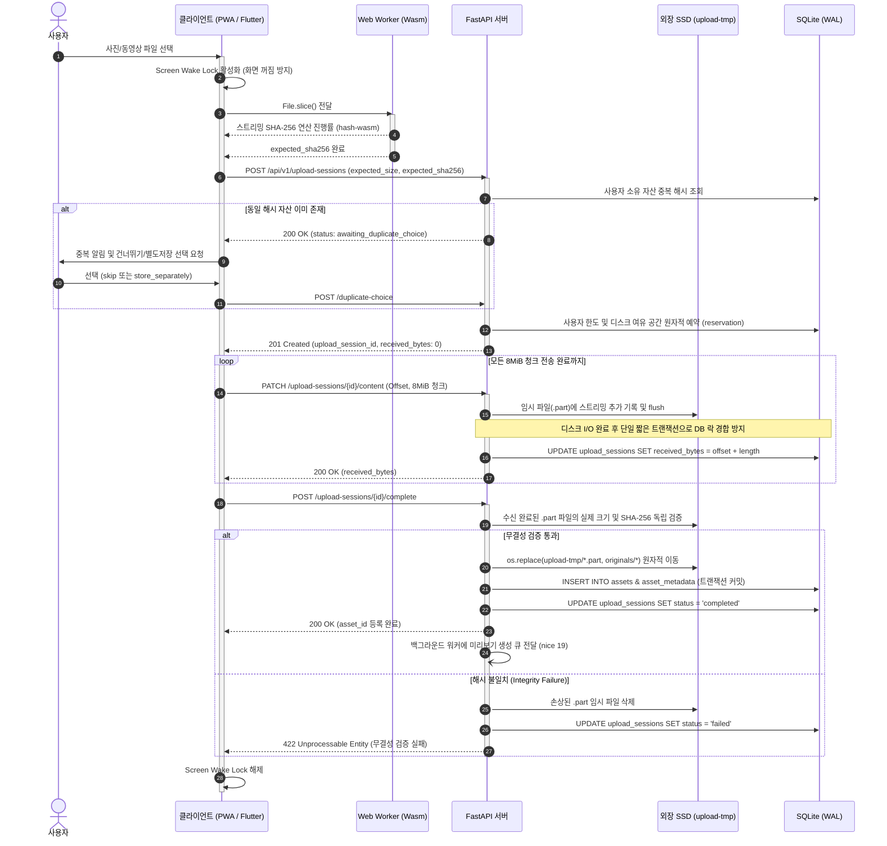
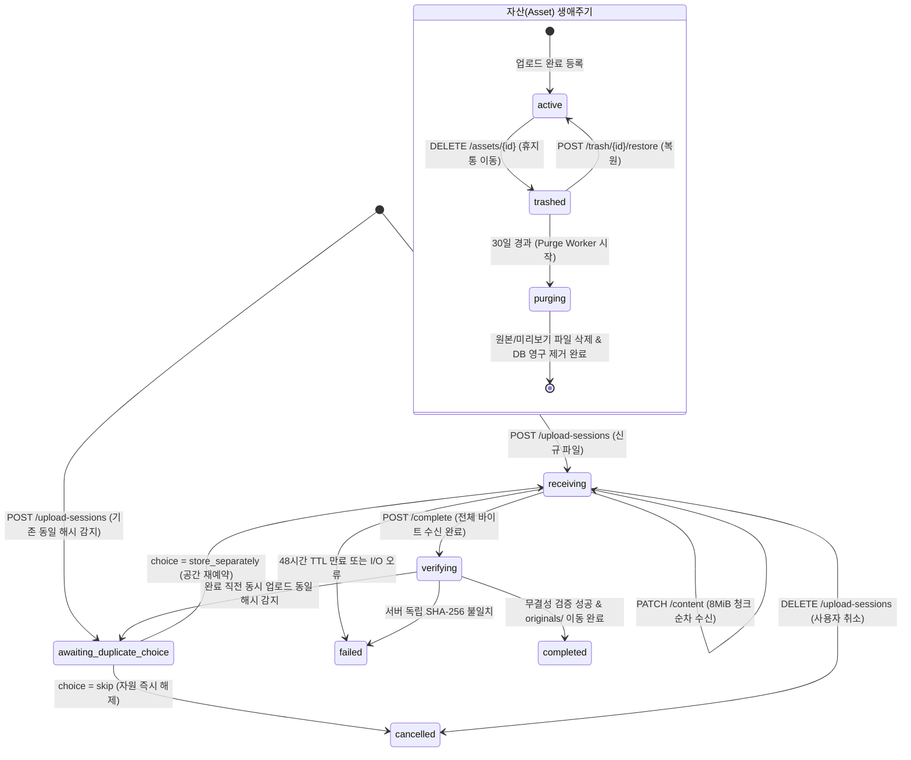
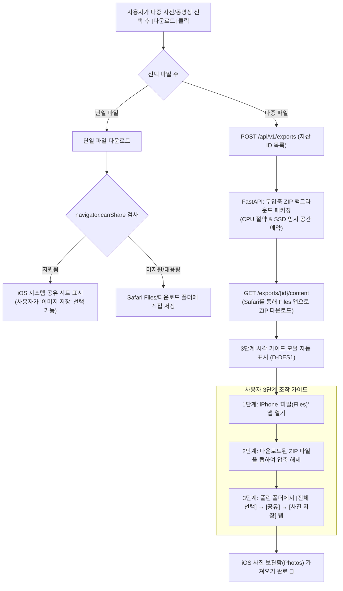
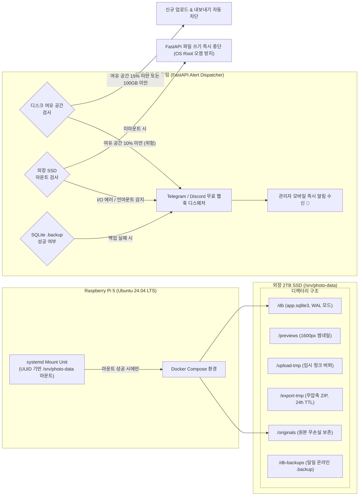

# 시스템 아키텍처

## 1. 플랫폼 구성

- Android: Flutter 네이티브 앱
- iOS: React + TypeScript 기반 PWA. Safari에서 HTTPS 웹사이트를 홈 화면에 추가해 사용
- 관리자: React + TypeScript 기반 별도 웹앱
- API: FastAPI
- DB: SQLite WAL 모드
- HTTPS/라우팅: Caddy
- 파일: Raspberry Pi의 Ubuntu 로컬 외장 SSD

iOS는 네이티브 iOS 앱이 아니므로 Xcode·Mac·IPA 빌드가 필요하지 않습니다. 웹 클라이언트는 Windows/Linux에서도 Node.js로 빌드할 수 있습니다. iPhone에서 앱과 유사한 경험을 제공하되 OS 파일·사진 접근은 Safari 웹 API의 범위에 따릅니다.

## 2. 네트워크와 호스트 분리

예시 호스트명이며 실제 도메인은 배포 시 설정합니다.

- photos.example.net: PWA와 일반 사용자 API, 인터넷 공개 HTTPS
- admin.example.net: 관리자 웹과 관리자 API, 내부 LAN만 허용

외부 인터넷에서 admin host로 요청하면 Caddy에서 차단합니다. 내부에서는 내부 DNS override로 admin host를 Raspberry Pi의 LAN IP로 해석하도록 권장합니다. 실제 외부/내부 경계는 배포 중 검증합니다.

공개 호스트에는 관리자 정적 파일 번들이나 관리자 API를 제공하지 않습니다. 관리자 role 검사와 네트워크 접근 제한을 모두 적용합니다.

## 3. 기술 스택

| 계층 | 선택 | 원칙 |
|---|---|---|
| Android | Flutter/Dart | 네이티브 갤러리·다운로드 통합 |
| iOS 사용자 웹 | React + TypeScript + Vite + PWA | 반응형 파일 선택·업로드·탐색, PWA 정적 셸 캐시 |
| 관리자 웹 | React + TypeScript + Vite | 별도 빌드 및 관리자 호스트 |
| API | FastAPI + Pydantic | 소유권 검증과 파일 처리 |
| DB | SQLite WAL | 단일 호스트의 로컬 파일시스템 |
| Reverse proxy | Caddy | HTTPS 및 host별 라우팅 |
| 이미지 | Pillow + HEIC decoder | 미리보기 전용, 원본은 변경하지 않음 |
| 동영상 | FFmpeg/ffprobe | 메타데이터·대표 이미지, 재인코딩 없음 |
| 운영 | Docker Compose + systemd | 외장 SSD mount guard |

## 4. 저장 경로

    /srv/photo-data/
      originals/{owner_uuid}/{asset_uuid}
      previews/{asset_uuid}.jpg
      upload-tmp/{upload_session_uuid}.part
      export-tmp/{export_uuid}.zip
      db/app.sqlite3
      db-backups/app-YYYY-MM-DD.sqlite3

- 저장 경로는 서버 생성 UUID이며 파일명은 DB 표시용입니다.
- 원본, 미리보기, 업로드 임시 파일, ZIP 내보내기를 분리합니다.
- ZIP은 기본 24시간 TTL 후 정리합니다.
- 임시 저장 공간을 전체 SSD 여유 공간 계산에 포함합니다.
- SSD 미마운트 시 OS 루트로 저장하는 fallback은 금지합니다.

## 5. 웹/PWA 캐시 및 업로드 재개

- Service worker는 HTML/CSS/JS/아이콘 같은 버전이 있는 정적 리소스만 캐시합니다.
- API, 인증, 원본, 미리보기, 동영상, ZIP은 캐시하지 않고 private/no-store 정책을 적용합니다.
- PWA는 File.slice()로 파일을 읽고 전송하며 대용량 파일 전체를 메모리에 적재하지 않습니다. 업로드 세션을 만들기 전에 Web Worker와 WebAssembly(Wasm) 가속 스트리밍 해시 라이브러리(hash-wasm 등)로 전체 SHA-256을 고속 계산해 재선택한 파일이 같은지 검증합니다. 해시 계산 진행률과 배터리 절감 상태를 UI에 표시합니다.
- 업로드 중에는 Screen Wake Lock API(navigator.wakeLock.request('screen'))를 호출하여 화면 꺼짐 및 Safari 백그라운드 전환에 따른 연결 단절을 방지하며, UI에 켜짐 유지 인디케이터를 표시합니다.
- 업로드 세션 ID와 acknowledged offset은 IndexedDB에 저장할 수 있습니다.
- 브라우저 종료 후 File 객체가 유지된다고 가정하지 않습니다. 파일 재선택을 요구할 수 있으며 최종 서버 SHA-256 불일치 시 자산 등록을 거부합니다.
- 백그라운드 지속 업로드를 보장하지 않습니다.

## 6. 업로드 흐름

1. 클라이언트가 파일을 전체 메모리에 적재하지 않고 읽어 expected SHA-256을 계산하며 진행률을 표시합니다.
2. 클라이언트가 original_name, expected_size, 필수 expected_sha256로 업로드 세션을 생성합니다.
3. 서버는 사용자 상태와 같은 사용자 소유의 기존 자산을 해시로 사전 조회합니다. 중복이면 파일 바이트 전송 전에 awaiting_duplicate_choice로 응답합니다.
4. skip이면 세션을 완료 처리하고 예약·임시 자원을 해제합니다. store_separately이면 할당량과 전체 여유 공간을 확인하고 receiving으로 전환합니다.
5. 새 파일이면 서버가 사용자 한도와 전체 SSD 여유 공간을 확인하고 예상 크기를 원자적으로 예약합니다.
6. 클라이언트가 8MiB 청크를 보내고, 서버가 예상 offset과 실제 offset이 같은지 검증합니다.
7. complete 단계에서 서버가 받은 파일의 실제 크기와 SHA-256을 독립 계산해 클라이언트가 사전 계산한 값을 검증합니다.
8. 사전 중복 확인 이후 다른 세션이 같은 해시를 먼저 등록한 경합 상황도 완료 단계에서 다시 확인하고 선택을 요구합니다.
9. 승인된 파일을 UUID 기반 최종 경로로 이동하고 DB 자산·메타데이터를 등록합니다. 완료 응답과 completed_asset_id를 저장해 반복 요청을 멱등 처리합니다.
10. 제한된 백그라운드 작업(동시성 1개 제한, nice 19)으로 미리보기를 생성해 라즈베리파이 5 부하를 방어합니다.

### 6.1 청크 업로드 시퀀스 다이어그램

### 6.2 업로드 세션 및 자산 상태 머신 전이도

사전 해시 계산은 대용량 파일의 시작 지연과 CPU/배터리 사용을 늘릴 수 있습니다. Wasm 가속 스트리밍 해시와 Web Worker를 통해 메인 스레드 멈춤 없이 빠른 준비를 보장합니다.

청크 전송 시 파일 I/O 스트리밍과 동기화를 먼저 완료한 후, 1ms 미만의 독립 트랜잭션으로 DB offset을 갱신하여 SQLite WAL 쓰기 락 경합(database is locked)을 차단합니다. 파일시스템 이동과 DB 트랜잭션은 원자적으로 묶이지 않으므로 commit 실패 시 고아 파일 후보를 기록하고 자산 목록에서 숨깁니다. reconciliation 작업은 유예 기간 후 파일/DB 상태를 다시 확인하고 정리합니다.

## 7. 원본 다운로드와 ZIP 내보내기

- 단일 사진·동영상은 소유권 확인 후 streaming response로 전달합니다.
- 동영상은 HTTP Range 지원을 사용해 부분 요청을 처리합니다.
- Android는 순차 다운로드 후 갤러리에 저장합니다.
- iOS PWA 단일 파일은 기본적으로 Files/다운로드에 저장합니다. 작은 파일은 navigator.canShare 검사 후 Web Share API를 선택적으로 사용할 수 있지만 Photos 저장 대상의 제공 여부는 OS가 결정합니다.
- iOS PWA 다중 선택은 서버 ZIP 내보내기를 사용합니다. ZIP은 Files에 저장되며, 다운로드 완료 시 사용자에게 '3단계 시각 가이드 모달'(Files 앱 열기 → 압축 해제 → 사진 보관함으로 공유/저장)을 노출하여 직관적인 사진 임포트를 지원합니다.
- ZIP은 무압축으로 CPU를 아끼고 예상 크기를 예약해 SSD를 보호합니다. ZIP 임시 공간은 사용자 사진 quota에는 포함하지 않고 전체 SSD 여유 공간 검사에 포함합니다.
- 사용자별 활성 export는 기본 1개, TTL은 24시간입니다.
- export가 참조하는 자산은 export 완료·취소·만료 전까지 영구 purge를 보류합니다.

## 8. 파일·DB 일관성 및 운영 알림

- 업로드 완료는 멱등적으로 처리하고 completed_asset_id를 보존합니다.
- 영구 삭제는 purging 상태와 재시도 가능한 purge job을 사용합니다.
- DB 상태를 먼저 기록하고 원본·미리보기를 멱등적으로 삭제한 뒤 DB 관계를 제거합니다.
- 서버 재시작 후 남은 purge job을 재실행합니다.
- DB row가 있으나 파일이 없으면 접근을 차단하고 오류로 표시합니다.
- DB row 없이 파일이 있으면 고아 파일 후보로 기록하고 즉시 삭제하지 않습니다.
- DB 백업은 SQLite online backup API(.backup)를 사용하여 트랜잭션 도중 복사로 인한 WAL 손상을 방지합니다.
- 디스크 90% 초과, 외장 SSD 언마운트, DB 백업 실패 등 치명적 운영 장애는 Telegram/Discord 무료 웹훅 디스패처로 즉시 관리자에게 통보합니다.

## 9. 날짜/EXIF 처리

시간대 정보가 있는 촬영 시각만 UTC로 변환합니다. 시간대 없는 EXIF DateTimeOriginal을 임의로 UTC로 간주하지 않습니다. 원본 문자열, 로컬 시각, offset 여부, UTC 값을 구분해 저장하고 시간대 미확정 데이터가 잘못 이동된 것처럼 표시되지 않도록 합니다.

## 10. 확장 경계

MVP는 단일 서버·SQLite·로컬 파일시스템입니다. PWA와 관리자 웹은 React 기술을 공유해도 빌드 산출물·호스트·세션 정책은 분리합니다. 사용자 증가나 복잡한 동시 쓰기 요구가 생기기 전까지 PostgreSQL, 객체 스토리지, 별도 작업 큐는 도입하지 않습니다.
